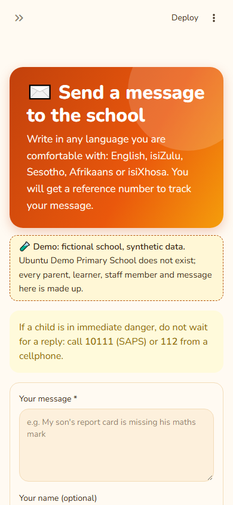
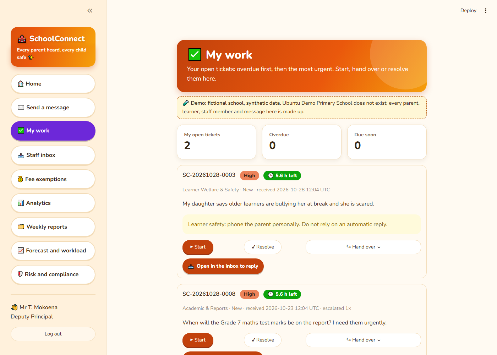
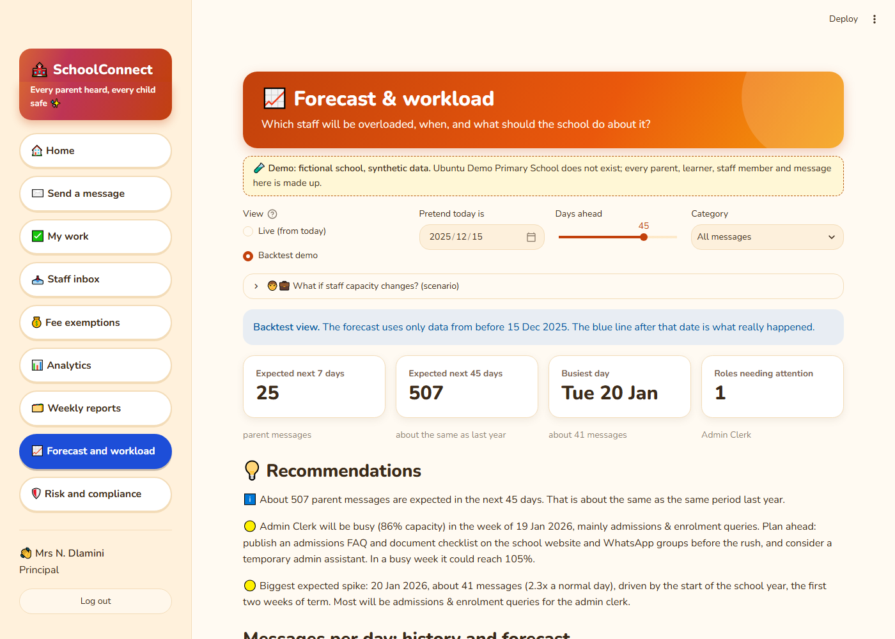

# SchoolConnect

**Every parent heard, every child safe: an AI help desk for South African public schools.**

Parents write in English, isiZulu, Sesotho, Afrikaans or isiXhosa. SchoolConnect:
- understands each message and gets it to the right staff member automatically;
- drafts a reply from the school's own facts;
- escalates anything that waits too long, and never lets a child-safety message get lost;
- gives the principal and SGB reports and a forecast of busy weeks, with POPIA built in.

## Live demo

| | Link |
|---|---|
| Web app (parents and staff) | **https://schoolconnect-web-cwa0.onrender.com** |
| API and interactive docs | **https://schoolconnect-api-0yhr.onrender.com/docs** |

> 🧪 **Demo: a fictional school with synthetic data.** "Ubuntu Demo Primary School" does not
> exist. The free servers sleep when unused, so **the first page can take about a minute**.
> Live smoke test: **9/9 checks passed** on 2026-10-29 ([WEEK_8.md](docs/weekly/WEEK_8.md)).
> Staff demo logins (principal, deputy, admin, finance, teacher, IT, all
> `…@ubuntu-demo.school.example`) are available on request.

| Parents (phone) | Staff: My work | Principal: January forecast |
|---|---|---|
|  |  |  |

More screenshots are in the [user guide](docs/USER_GUIDE.md).

## The problem

- School offices are overwhelmed, especially in January and during admissions.
- Teachers are pulled into admin.
- Messages get lost in WhatsApp groups, and parents wait days and then write again.
- A message about a bullied or missing child can sit behind forty fee questions.
- Principals have no figures to plan with.

## The solution

1. **Classify** each message: 7 topics, 4 urgency levels, 5 languages. It works fully offline; an
   AI is optional.
2. **Protect children first.** Abuse, missing children, weapons and self-harm are always
   **critical**, go straight to the deputy principal, and always need a person.
3. **Assign** each message to the right person with the least open work, and **escalate** it
   automatically when the school's promised response time is missed.
4. **Reply** with drafts built only from the school's facts. A person approves every reply.
5. **Report and predict**: analytics, weekly PDF reports, a forecast of workload per role, and a
   risk and POPIA report.

## Features by week

| Week | Module | Highlights |
|---|---|---|
| 1 | Classification engine | multilingual rules, optional Claude/Gemini with fallback, child-safety guardrails |
| 2 | Automated responses *(built in Week 6)* | facts-only templates, three tones, grounding check on any AI rewrite |
| 3 | Analytics dashboard *(built after Week 7)* | volumes, response times, "answered on time", trends, plain-language insights |
| 4 | Business reports *(built after Week 7)* | weekly PDF per department, made automatically every Monday |
| 5 | Predictive insights | 4 forecasting methods, leakage-free backtest, staff workload, spike alerts |
| 6 | AI risk & compliance | PII masking, audit log, fairness checks, 23 prompt-injection checks, risk PDF, retention |
| 7 | Workflow & integration | logins and roles, auto-assignment, SLAs, escalation, notifications, fee exemptions, signed webhook |
| 8 | Deployment & showcase | Render + Supabase + GitHub Actions, production checks, stored forecasts, 30–60× faster workload maths, docs |

## Headline results

| Result | |
|---|---|
| Classifier accuracy (150 labelled messages, 5 languages) | **96.0%**, **0 of 6** critical cases missed |
| January 2026 rush, forecast from 15 Dec 2025 | forecast **421** vs actual **486** (16% error); 84% of days in the 80% range |
| Admin clerk, busiest January week | forecast **86%** of capacity, actual **88%** |
| Prompt-injection checks | **23 / 23** pass (even against an AI that obeys the attack) |
| Automated tests | **402** passing on every push |
| Peak memory on the free 512 MB server | **250 MB** (measured with the CPU capped at 0.1 core) |
| Estimated office time saved | **≈ 144 hours a term** (stated assumptions, [business case](docs/BUSINESS_CASE.md)) |

The data is synthetic, so the accuracy figures are optimistic ([DATA.md](docs/DATA.md)). A pilot
at a real school is the next step.

## Tech stack

- **Backend:** Python 3.11, FastAPI, SQLAlchemy 2.0, Pydantic v2
- **Frontend:** Streamlit, plotly
- **Analysis and reports:** pandas, scikit-learn, reportlab
- **Data and hosting:** Postgres on **Supabase**, two free web services on **Render**, scheduled
  jobs and CI on **GitHub Actions**
- **Optional AI:** Anthropic Claude or Google Gemini (off by default)

## Run it locally

```bash
python -m venv .venv
.venv\Scripts\activate                 # macOS/Linux: source .venv/bin/activate
pip install -r requirements-dev.txt    # backend + frontend + test tools
copy .env.example .env                 # macOS/Linux: cp .env.example .env

pytest                                 # 402 tests, no internet or API key needed

# Demo data (--reset deletes ALL tables first):
python scripts/generate_history.py --reset
python scripts/demo_week6.py --password "pick-a-demo-password"
python scripts/demo_week7.py --password "pick-a-demo-password"   # prints the demo staff logins
python scripts/make_weekly_reports.py --weeks 4

uvicorn app.main:app --reload          # API on http://localhost:8000 (docs at /docs)
streamlit run frontend/Home.py         # second terminal: app on http://localhost:8501
```

- **Turning on an AI:** set `LLM_PROVIDER=anthropic` and `ANTHROPIC_API_KEY=...` in `.env`.
  Without a key, the rules classifier is used.
- **Deploying it yourself:** see [DEPLOYMENT.md](docs/DEPLOYMENT.md).

## Documentation

| For | Read |
|---|---|
| Parents, staff, principal | [User guide](docs/USER_GUIDE.md) |
| Panel and decision-makers | [Business case](docs/BUSINESS_CASE.md) · [Presentation](docs/PRESENTATION.md) |
| Technical reviewers | [Technical documentation](docs/TECHNICAL.md) · [Architecture](docs/ARCHITECTURE.md) · [Forecasting](docs/FORECASTING.md) · [Integrations](docs/INTEGRATIONS.md) |
| Deploying | [Deployment guide](docs/DEPLOYMENT.md) |
| Privacy | [POPIA](docs/POPIA.md) |
| Evaluations | [Classifier](docs/classifier_evaluation.md) · [Forecast](docs/forecast_evaluation.md) · [Data](docs/DATA.md) |
| History | [Roadmap](docs/ROADMAP.md) · [Changelog](CHANGELOG.md) · weekly reports: [1](docs/weekly/WEEK_1.md) · [3–4](docs/weekly/WEEK_3_4.md) · [5](docs/weekly/WEEK_5.md) · [6](docs/weekly/WEEK_6.md) · [7](docs/weekly/WEEK_7.md) · [8](docs/weekly/WEEK_8.md) |

## Project structure

```
app/            FastAPI backend: taxonomy, classifier, responses, analytics, reports, forecasting,
                privacy, risk, auth, workflow, notify, integrations, API routers
config/         school facts, calendar, workload, workflow rules, risk register (YAML)
frontend/       Streamlit app (talks to the API over HTTP only)
scripts/        demo data, evaluations, scheduled-job scripts, smoke test, measurements, screenshots
tests/          402 pytest tests
docs/           everything above, plus screenshots/
render.yaml     Render Blueprint (two free web services)
```

## What I learned

_To be written by Dikeledi: three or four honest lessons, for example about designing for child
safety first, measuring before optimising, and explaining AI decisions to non-technical people._

## About me

_To be written by Dikeledi: a short introduction, the bootcamp, what you want to work on next, and
how to contact you (LinkedIn / email)._
