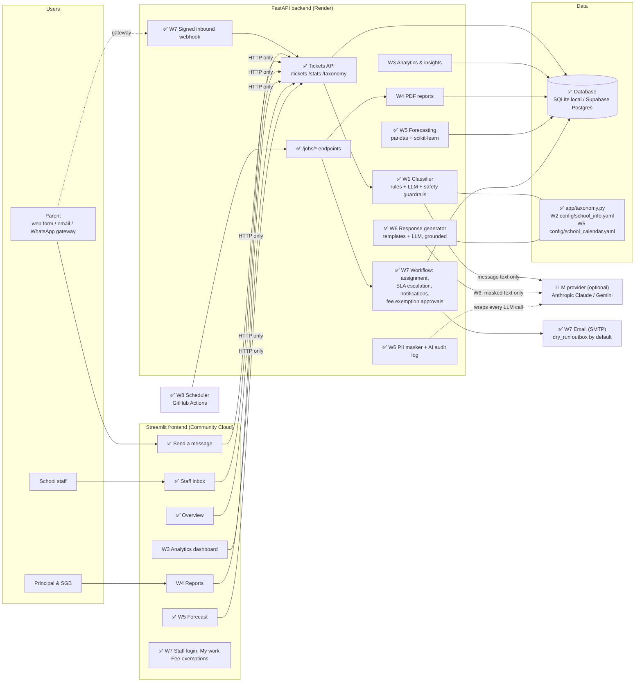
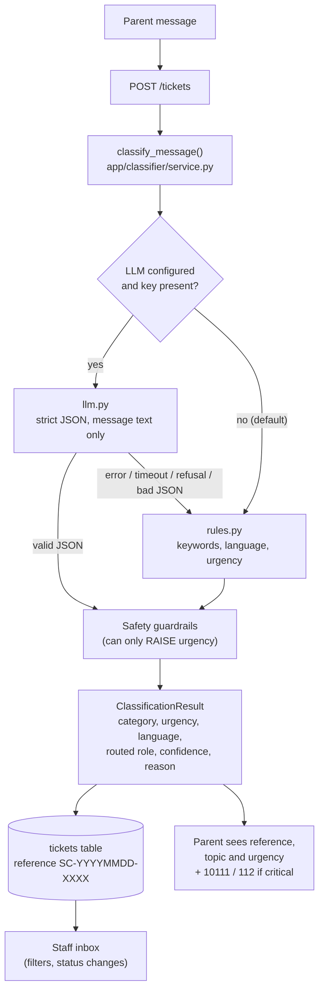
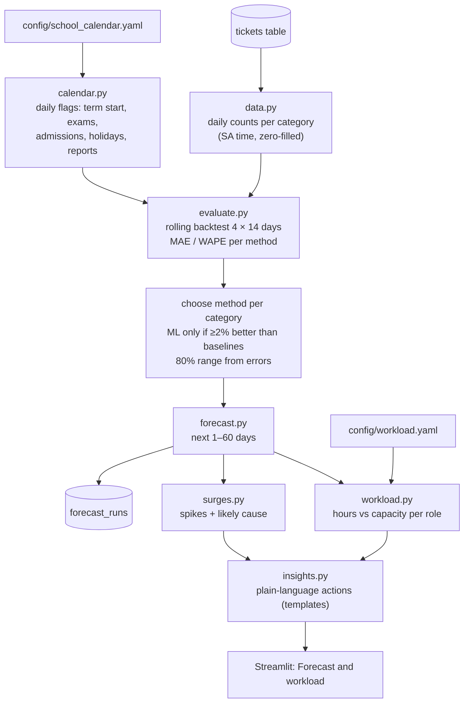
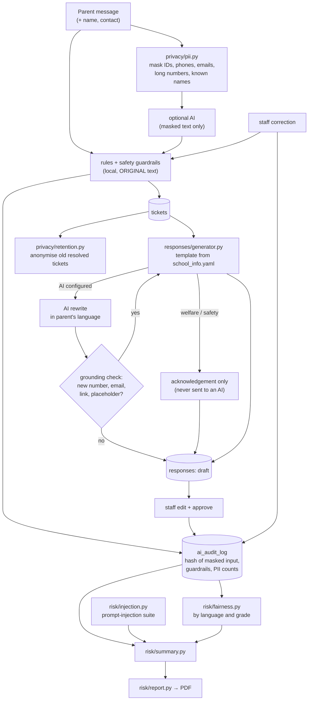
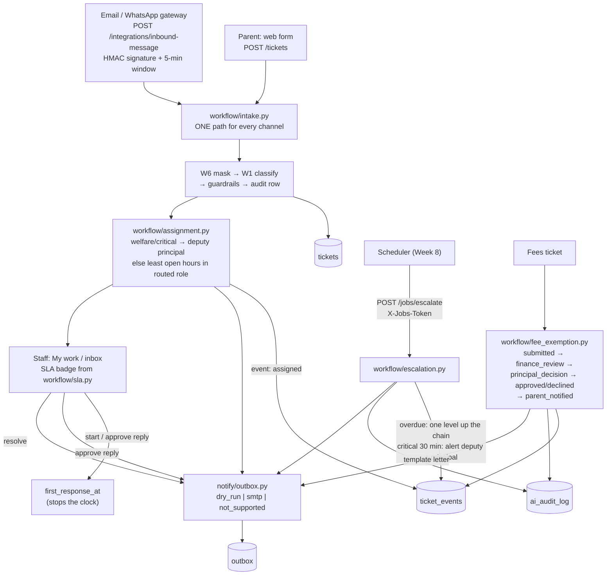
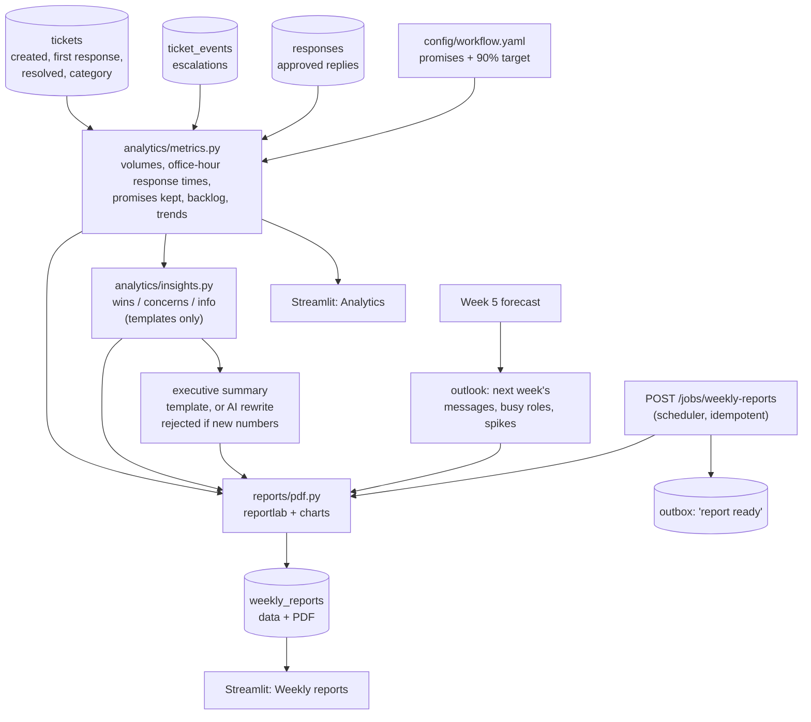
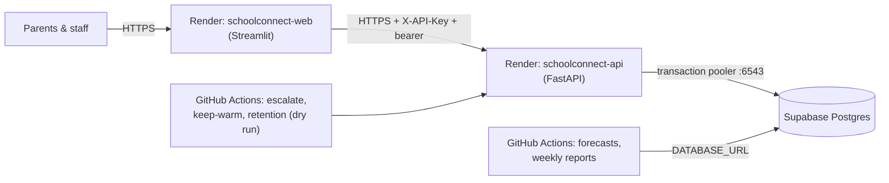

# SchoolConnect architecture

## Target system (all 8 weeks)

Solid boxes with a ✅ exist now. The other boxes are planned for the week shown.

## What exists now (end of Week 1)

### Components

| Part | File(s) | Responsibility |
|---|---|---|
| Taxonomy | `app/taxonomy.py` | Single source of truth: categories, routed roles, multilingual keywords, urgency, languages, statuses, safety keywords |
| Settings | `app/config.py` | Reads `.env` / environment (pydantic-settings) |
| Database | `app/db.py`, `app/models.py` | SQLAlchemy engine/session; `Ticket` table |
| Data access | `app/crud.py` | Create/list/filter tickets, references, status changes, stats |
| API schemas | `app/schemas.py` | Pydantic validation; allowed values built from the taxonomy |
| Rules classifier | `app/classifier/rules.py` | Keyword scoring, language detection, urgency words, safety term detection |
| LLM classifier | `app/classifier/llm.py` | Prompt built from the taxonomy, strict JSON, validation; any failure returns `None` |
| Orchestration | `app/classifier/service.py` | LLM → rules fallback → guardrails |
| API | `app/main.py` | FastAPI endpoints, CORS, optional API key |
| Frontend | `frontend/` | Streamlit pages; `api_client.py` is the only link to the backend |
| Scripts | `scripts/seed_db.py`, `scripts/evaluate_classifier.py` | Demo data, evaluation report |

### Safety guardrails (applied to rules AND LLM output)

| ID | Trigger | Effect |
|---|---|---|
| G1 | Critical safety term in the raw text (abuse, missing child, weapon, self-harm…) | urgency → `critical`, category → `learner_welfare`, routed to deputy principal, `needs_human` |
| G2 | Wellbeing term (bullying, injury, scared…) | urgency → at least `high`, `needs_human`; category unchanged |
| G3 | Category is `learner_welfare` | urgency → at least `high`, `needs_human` |
| G4 | Confidence < 0.35 | `needs_human` (a person checks the category) |

Guardrails look at the **original message**, so an LLM (or a prompt-injection
attempt inside the message) cannot talk its way past them.

### API endpoints

| Method | Path | Access | Purpose |
|---|---|---|---|
| GET | `/health` | public | Liveness + active AI provider |
| GET | `/taxonomy` | public | Categories, urgency, languages, statuses, roles, grades |
| POST | `/classify` | public | Classify only, nothing saved |
| GET | `/stats` | public | Counts only, no personal data |
| GET | `/tickets/by-reference/{ref}` | public | Parent progress check: status only, no message or personal data |
| POST | `/tickets` | API key* | Create + classify a ticket |
| GET | `/tickets` | API key* | List with filters: status, category, urgency, language, routed_role, needs_human, search |
| GET | `/tickets/{id}` | API key* | Full ticket (staff) |
| PATCH | `/tickets/{id}/status` | API key* | Change status (sets/clears `resolved_at`) |

\* Only enforced when `API_KEY` is set. The Streamlit server holds the key; parents never see it.

### Data model (Week 1)

`tickets`: id, reference (unique), message, parent_name, parent_contact,
learner_grade, channel, category, urgency, language, routed_role, confidence,
method, needs_human, safety_flag, reason, status, created_at, updated_at, resolved_at.

### Key design decisions

- **Rules first, LLM optional.** The app is fully usable offline and in CI. The LLM can improve accuracy but is never required.
- **Only the message text reaches the LLM.** Name, contact and grade are stored but never sent. (Week 6 adds PII masking of the text itself.)
- **Strict, validated JSON.** Claude is called with a JSON-schema output format. Every field is checked against the taxonomy, and anything invalid falls back to rules.
- **The official Anthropic SDK** is used for Claude. Gemini is called over plain HTTPS with `httpx` to avoid a large SDK, which keeps the API small for Render's 512 MB free instance.
- **Frontend over HTTP only**, so it is deployed as its own service (Render `schoolconnect-web`) next to
  the API (Render `schoolconnect-api`).

## Week 5 additions: predictive insights

`app/forecasting/service.py` runs this pipeline once per forecast date and caches it; the
cache key includes the ticket count, so a new ticket triggers a fresh forecast. Endpoints only
slice the cached result.

| Part | File(s) | Responsibility |
|---|---|---|
| Calendar | `app/forecasting/calendar.py`, `config/school_calendar.yaml` | Daily yes/no flags from the (approximate) school calendar |
| Data | `app/forecasting/data.py` | Tickets → daily counts per category in South African time |
| Methods | `app/forecasting/models.py` | Same as last week, same day last year, recent average, gradient boosting |
| Backtest | `app/forecasting/evaluate.py` | Leakage-free rolling backtest, method choice, 80% ranges |
| Forecast | `app/forecasting/forecast.py` | Next 1–60 days per category and in total |
| Workload | `app/forecasting/workload.py`, `config/workload.yaml` | Hours needed vs available per role; busy-week and staff scenarios |
| Spikes | `app/forecasting/surges.py` | Days ≥ 1.5× a normal day, with cause and extra hours |
| Insights | `app/forecasting/insights.py` | Template recommendations (cannot invent facts) |
| Orchestration | `app/forecasting/service.py` | Pipeline, cache, API slices, stored runs |
| History | `app/synthetic.py`, `scripts/generate_history.py` | Synthetic demo history |

### Week 5 endpoints

| Method | Path | Access | Purpose |
|---|---|---|---|
| GET | `/analytics/history` | API key* | Actual tickets per day (charts) |
| GET | `/forecast` | API key* | Forecast rows with 80% range, method used; actuals in backtest view |
| GET | `/forecast/workload` | API key* | Hours and utilisation per role, daily and weekly; `staff=admin_clerk:2` scenario |
| GET | `/forecast/surges` | API key* | Expected spikes with likely cause |
| GET | `/forecast/insights` | API key* | Plain-language recommendations |
| GET | `/forecast/evaluation` | API key* | Backtest accuracy per method and category |
| POST | `/jobs/refresh-forecast` | X-Jobs-Token | Recompute and store a forecast run (for the Week 8 scheduler) |

All forecast endpoints accept `as_of=YYYY-MM-DD` (a past date gives the backtest view) and `days` (1–60).

### Data model (Week 5)

`forecast_runs`: id, created_at, as_of, horizon_days, chosen_models (JSON), metrics (JSON), forecast (JSON).
The forecaster reads only `tickets.created_at` and `tickets.category`; no personal data.

## Week 6 additions: AI risk & compliance layer

| Part | File(s) | Responsibility |
|---|---|---|
| PII masker | `app/privacy/pii.py` | Masks SA IDs (Luhn), phones, emails, long numbers, known names; log-record redaction |
| Retention | `app/privacy/retention.py` | Anonymise resolved tickets older than `RETENTION_DAYS` (dry run by default) |
| Audit | `app/audit.py`, `ai_audit_log` | One row per AI decision or human action; no raw personal data |
| Reply templates | `app/responses/templates.py`, `config/school_info.yaml` | Facts and three tones; acknowledgement-only text for welfare |
| Reply generator | `app/responses/generator.py`, `app/llm_text.py` | Optional AI rewrite with masked input and a grounding check |
| Corrections | `crud.correct_classification` | Staff override, guardrails re-applied, audit row |
| Fairness | `app/risk/fairness.py` | Accuracy, waiting time, correction rate by language and grade band |
| Injection suite | `app/risk/injection.py`, `data/prompt_injection_cases.json` | Rules, obedient-AI simulation, tag wrapping, reply grounding |
| Risk summary / PDF | `app/risk/summary.py`, `app/risk/report.py`, `config/risk_register.yaml` | Counts-only summary and 3-page report |

### Week 6 endpoints

| Method | Path | Access | Purpose |
|---|---|---|---|
| POST | `/tickets/{id}/responses` | API key* | Draft a reply (`tone`: formal, friendly, urgent) |
| GET | `/tickets/{id}/responses` | API key* | Reply drafts for a ticket |
| PATCH | `/responses/{id}` | API key* | Staff edit a draft (logged) |
| POST | `/responses/{id}/approve` | API key* | Staff approve a reply (logged) |
| PATCH | `/tickets/{id}/classification` | API key* | Staff correct category/urgency; guardrails re-applied |
| GET | `/tickets/{id}/audit` | API key* | Audit trail for one ticket |
| POST | `/privacy/tickets/{id}/anonymise` | API key* | POPIA: remove personal data on request |
| GET | `/risk/summary` | API key* | Counts: AI decisions, guardrails, PII masked, overrides, fairness, injection, register |
| GET | `/risk/fairness` | API key* | Fairness report |
| GET | `/risk/report.pdf` | API key* | Risk evaluation PDF |
| POST | `/jobs/retention` | X-Jobs-Token | Retention run; `dry_run=true` by default |

### Data model (Week 6)

- `responses`: id, ticket_id, tone, language, body, original_body, method, acknowledgement_only,
  status (draft/approved), edited, notes, created_at, updated_at, approved_at, approved_by.
- `ai_audit_log`: id, created_at, feature, ticket_id, method, model, llm_used, fallback_reason,
  input_hash (SHA-256 of masked input), output (JSON), guardrails (JSON), pii_found (counts),
  human_override, actor.

New tables are created automatically on startup; existing tables are unchanged, so a Week 5
database keeps working.

## Week 7 additions: workflow automation & system integration

### One message, end to end

### Components

| Part | File(s) | Responsibility |
|---|---|---|
| Passwords | `app/auth/passwords.py` | PBKDF2-SHA256, per-user salt, iterations in the hash, `compare_digest` |
| Accounts & sessions | `app/auth/service.py` | Create staff, login with lockout (5 → 15 min), 8-hour tokens stored as SHA-256 |
| Access rules | `app/auth/access.py`, `app/auth/deps.py` | Who may see which ticket; `current_staff`, `require_roles(...)` |
| Migration | `app/db.py: migrate()` | Adds missing columns at startup (SQLite + Postgres), idempotent |
| Events | `app/workflow/events.py` | Timeline rows; `exists()` keeps jobs idempotent |
| Intake | `app/workflow/intake.py` | The one path for web + webhook messages |
| Assignment | `app/workflow/assignment.py` | Least open hours (`config/workload.yaml`), tie-break, welfare routing, reassignment |
| SLAs | `app/workflow/sla.py`, `config/workflow.yaml` | Due times on school days/office hours (Week 5 calendar); on_track/due_soon/overdue/met |
| Escalation | `app/workflow/escalation.py` | One level up per breach; critical 30-minute alert; events + audit |
| Notifications | `app/notify/outbox.py`, `app/notify/messages.py` | Outbox (dry run / SMTP); POPIA-safe staff alerts; parent letters from school facts |
| Fee exemptions | `app/workflow/fee_exemption.py`, `app/api/fees.py` | Strict state machine, role checks (403), state checks (409) |
| Inbound webhook | `app/integrations/inbound.py`, `app/api/integrations.py` | HMAC-SHA256 over `timestamp.body`, replay window |
| Routers | `app/api/auth.py`, `app/api/workflow.py`, `app/api/fees.py`, `app/api/integrations.py` | Keep `main.py` small |
| Frontend | `frontend/auth.py`, `pages/2_My_work.py`, `pages/4_Fee_exemptions.py` | Login, role guard, quick actions, approval queues |

### Access from Week 7

Every endpoint marked "API key*" in the Week 1, 5 and 6 tables now **also needs a staff login**
(`Authorization: Bearer <token>`), and only returns tickets that person may see:

| Role | Tickets | Forecast & risk | Fee steps |
|---|---|---|---|
| Principal | all | yes | final decision, letter |
| Deputy principal | own role, assigned to them, **all welfare/safety** | yes | – |
| Finance clerk | own role (fees) or assigned, never welfare | no | review, checklist, recommendation, letter |
| Admin clerk / class teacher / IT support | own role or assigned, never welfare | no | – |
| Parent (no login) | `POST /tickets`, `GET /tickets/by-reference/{ref}` (status + reply status only) | no | – |

### Week 7 endpoints

| Method | Path | Access | Purpose |
|---|---|---|---|
| POST | `/auth/login` | public | Email + password → 8-hour bearer token (423 when locked) |
| POST | `/auth/logout` | staff | End this session |
| GET | `/auth/me` | staff | Who am I |
| GET | `/staff` | staff | Colleagues (for reassignment) |
| GET | `/workflow/my-work` | staff | My open tickets, overdue first, with SLA |
| GET | `/tickets/{id}/events` | staff (visible ticket) | Timeline |
| POST | `/tickets/{id}/assign` | staff (visible ticket) | Reassign (welfare only to senior staff) |
| GET | `/tickets/{id}/outbox` | staff (visible ticket) | Notifications and their status |
| POST | `/tickets/{id}/fee-exemption` | staff (visible fees ticket) | Start a request |
| GET | `/fee-exemptions`, `/fee-exemptions/{id}` | finance clerk, principal | Queues |
| POST | `/fee-exemptions/{id}/start-review` | finance clerk | submitted → finance_review |
| PUT | `/fee-exemptions/{id}/checklist` | finance clerk | Tick documents |
| POST | `/fee-exemptions/{id}/finance-decision` | finance clerk | Recommend approve/decline → principal_decision |
| POST | `/fee-exemptions/{id}/principal-decision` | principal | approved / declined |
| POST | `/fee-exemptions/{id}/notify-parent` | finance clerk, principal | Letter → parent_notified |
| POST | `/integrations/inbound-message` | HMAC signature | Ticket from an email / WhatsApp gateway |
| POST | `/jobs/escalate` | X-Jobs-Token | Escalate overdue tickets; critical alerts |

`TicketOut` now includes `assigned_to`, `first_response_at`, `escalation_level` and `sla`;
`ResponseOut` includes `delivery_status`; `TicketPublic` includes `reply_status`.

### Data model (Week 7)

- `staff`: id, name, email (unique), role, active, password_hash, failed_logins, locked_until, created_at.
- `staff_sessions`: id, token_hash (SHA-256, unique), staff_id, expires_at, created_at.
- `ticket_events`: id, ticket_id, type, from_value, to_value, actor, created_at.
- `outbox`: id, recipient, channel, kind, subject, body, ticket_id, response_id, status
  (dry_run / sent / failed / not_supported), error, created_at, sent_at.
- `fee_exemptions`: id, ticket_id (unique), status, checklist (JSON), finance_decision, finance_note,
  finance_by, finance_at, principal_decision, principal_by, principal_at, decline_reason, created_at.
- `tickets` gains: assigned_to, first_response_at, escalation_level, escalated_at (added to older
  databases by `migrate()` at startup).

### Design decisions

- **AI decisions vs workflow.** AI decisions stay in `ai_audit_log`; workflow steps go to
  `ticket_events`. Escalations and fee decisions are written to both, because they are decisions the
  principal may need to account for.
- **Idempotent escalation.** A new owner gets a fresh response window, counted from `escalated_at`.
  So a second run at the same moment finds nothing overdue, and no lock or "already done" table is
  needed. Critical alerts are sent once, checked through `events.exists()`.
- **Safe outbox by default.** `dry_run` is the default, so a demo or a test can never email a real
  parent.
- **Signed timestamp.** The webhook signs `timestamp.body`, not just the body. An old signature can
  then not be replayed with a new timestamp.

## Weeks 3–4 additions: analytics dashboard and weekly business reports

Weeks 3 and 4 were skipped in the bootcamp schedule and built after Week 7, so they reuse the
Week 7 data (first responses, events, escalations, logins) and the Week 5 forecast.

| Part | File(s) | Responsibility |
|---|---|---|
| Departments | `app/taxonomy.py` (`DEPARTMENT_NAMES`, `categories_for_department`) | Whole school + one department per routed staff role, derived from category routing |
| Metrics | `app/analytics/metrics.py` | Figures for a period vs the previous one; weekly trends. Office hours from the Week 7 SLA calendar |
| Insights | `app/analytics/insights.py` | Plain-language wins/concerns, executive summary (optional AI, number-checked), outlook from the forecast |
| Report | `app/reports/weekly.py`, `app/reports/pdf.py` | Build, store and list weekly reports; access by role; scheduled job |
| API | `app/api/reports.py`, `/jobs/weekly-reports` in `app/main.py` | Dashboard data, reports, PDF download |
| Script | `scripts/make_weekly_reports.py` | Same as the job, from the command line |

### Weeks 3–4 endpoints

| Method | Path | Access | Purpose |
|---|---|---|---|
| GET | `/analytics/scopes` | staff login | Departments I may see (principal: all; deputy: school + welfare; others: own) |
| GET | `/analytics/summary` | staff login | Figures for `start`..`end` (default last full week) + insights + summary |
| GET | `/analytics/trends` | staff login | Weekly messages, median first response, on-time rate (`weeks` 1–52) |
| GET | `/reports/weeks` | staff login | Mondays of recent completed weeks |
| GET | `/reports` | staff login | Stored reports I may see |
| POST | `/reports/weekly` | staff login | Make (or remake) a report for a week and department |
| GET | `/reports/{id}/pdf` | staff login | Download a stored report (404 if not allowed) |
| POST | `/jobs/weekly-reports` | X-Jobs-Token | Make last week's reports for every department; keeps existing unless `force` |

### Data model (Weeks 3–4)

`weekly_reports`: id, week_start (Monday), scope ("school" or a staff role), created_at, created_by
(staff name or "scheduler"), summary_method, data (JSON figures and insights; counts only), pdf (bytes).

### Design decisions

- **Office hours, not clock hours.** Response times exclude evenings, weekends and public holidays,
  so a Friday-evening message answered on Monday morning is not "65 hours late".
- **Median, not average.** One very slow reply does not distort the picture.
- **Two moments.** Response times use everything known when the figures are calculated; the backlog
  is "as at the end of the period".
- **Rounding never hides a miss:** 89.5% against a 90% target is shown as 89.5%, not 90%.
- **Single-threaded forecasting model.** The API runs each request in its own thread; letting every
  thread start its own OpenMP pool made later forecasts about 4× slower on a 2-core machine, so the
  (small) gradient-boosting model is limited to one thread. Results are identical.
- **Week 8 note:** the scheduled job builds 6 reports including a forecast outlook (~15–30 s on a
  laptop, ~150 s on Render's 0.1 CPU). So in production `scripts/make_weekly_reports.py` runs on a
  GitHub Actions schedule, connected straight to Supabase, instead of calling the Render API.

## Week 8 additions: deployment and optimisation

The production architecture, with the full module list, data model, API summary, security notes and
measurements, is in [TECHNICAL.md](TECHNICAL.md). In short:

| Part | File(s) | Responsibility |
|---|---|---|
| Blueprint | `render.yaml`, `.python-version` | two free web services in Frankfurt, Python 3.11, secrets never in git |
| Database engine | `app/db.py` | psycopg 3, small pool, prepared statements off on the transaction pooler |
| Production checks | `app/config.py: check_production_settings` | refuse to start without secrets, with weak hashing, or on SQLite |
| Stored forecasts | `app/forecasting/service.py`, `stored_forecasts` | signed bundles for today and pinned dates; endpoints read them first |
| Scheduled jobs | `.github/workflows/jobs.yml`, `scripts/call_endpoint.py`, `scripts/refresh_forecasts.py` | light calls to the API; heavy work on GitHub against Supabase |
| Checks and measurements | `scripts/smoke_test_prod.py`, `scripts/measure_performance.py`, `scripts/take_screenshots.py` | live smoke test, memory/CPU measurements, screenshots |

### Data model (Week 8)

`stored_forecasts`: id, as_of, fingerprint (SHA-256 of the history used), versions (Python / pandas /
numpy / scikit-learn), payload (pickled bundle without actuals), signature (HMAC-SHA256), seconds,
created_at.
