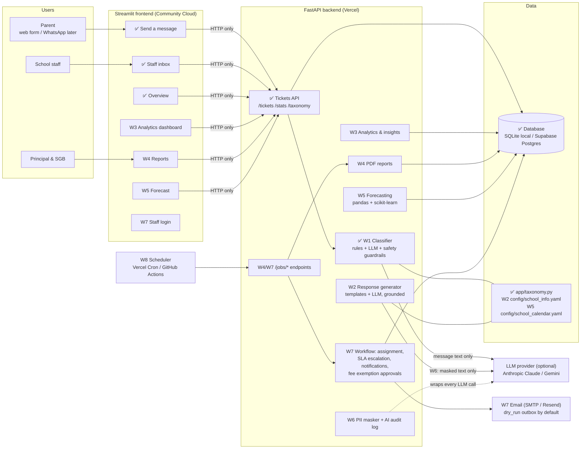
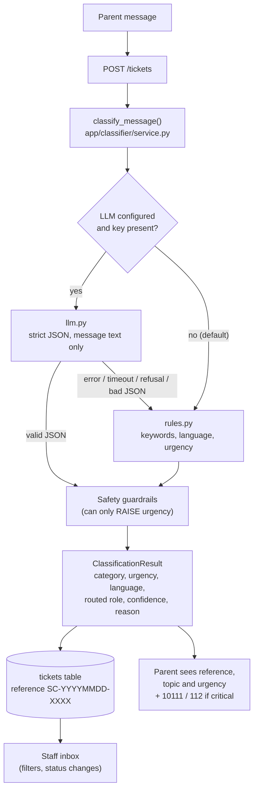
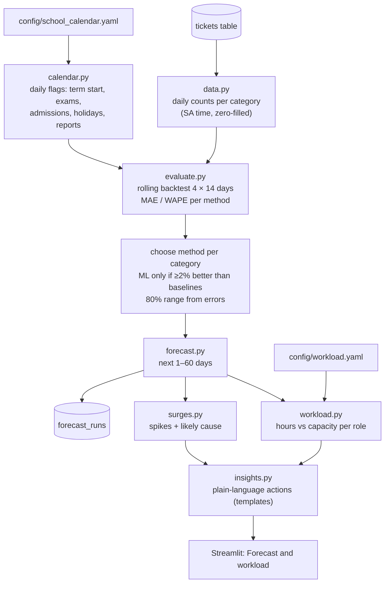

# SchoolConnect architecture

## Target system (all 8 weeks)

Solid boxes with a ✅ exist now. The other boxes are planned for the week shown.

## What exists now (end of Week 1)

### Components

| Part | File(s) | Responsibility |
|---|---|---|
| Taxonomy | `app/taxonomy.py` | Single source of truth: categories, routed roles, multilingual keywords, urgency, languages, statuses, safety keywords |
| Settings | `app/config.py` | Reads `.env` / environment (pydantic-settings) |
| Database | `app/db.py`, `app/models.py` | SQLAlchemy engine/session; `Ticket` table |
| Data access | `app/crud.py` | Create/list/filter tickets, references, status changes, stats |
| API schemas | `app/schemas.py` | Pydantic validation; allowed values built from the taxonomy |
| Rules classifier | `app/classifier/rules.py` | Keyword scoring, language detection, urgency words, safety term detection |
| LLM classifier | `app/classifier/llm.py` | Prompt built from the taxonomy, strict JSON, validation; any failure returns `None` |
| Orchestration | `app/classifier/service.py` | LLM → rules fallback → guardrails |
| API | `app/main.py` | FastAPI endpoints, CORS, optional API key |
| Frontend | `frontend/` | Streamlit pages; `api_client.py` is the only link to the backend |
| Scripts | `scripts/seed_db.py`, `scripts/evaluate_classifier.py` | Demo data, evaluation report |

### Safety guardrails (applied to rules AND LLM output)

| ID | Trigger | Effect |
|---|---|---|
| G1 | Critical safety term in the raw text (abuse, missing child, weapon, self-harm…) | urgency → `critical`, category → `learner_welfare`, routed to deputy principal, `needs_human` |
| G2 | Wellbeing term (bullying, injury, scared…) | urgency → at least `high`, `needs_human`; category unchanged |
| G3 | Category is `learner_welfare` | urgency → at least `high`, `needs_human` |
| G4 | Confidence < 0.35 | `needs_human` (a person checks the category) |

Guardrails look at the **original message**, so an LLM (or a prompt-injection
attempt inside the message) cannot talk its way past them.

### API endpoints

| Method | Path | Access | Purpose |
|---|---|---|---|
| GET | `/health` | public | Liveness + active AI provider |
| GET | `/taxonomy` | public | Categories, urgency, languages, statuses, roles, grades |
| POST | `/classify` | public | Classify only, nothing saved |
| GET | `/stats` | public | Counts only, no personal data |
| GET | `/tickets/by-reference/{ref}` | public | Parent progress check: status only, no message or personal data |
| POST | `/tickets` | API key* | Create + classify a ticket |
| GET | `/tickets` | API key* | List with filters: status, category, urgency, language, routed_role, needs_human, search |
| GET | `/tickets/{id}` | API key* | Full ticket (staff) |
| PATCH | `/tickets/{id}/status` | API key* | Change status (sets/clears `resolved_at`) |

\* Only enforced when `API_KEY` is set. The Streamlit server holds the key; parents never see it.

### Data model (Week 1)

`tickets`: id, reference (unique), message, parent_name, parent_contact,
learner_grade, channel, category, urgency, language, routed_role, confidence,
method, needs_human, safety_flag, reason, status, created_at, updated_at, resolved_at.

### Key design decisions

- **Rules first, LLM optional.** The app is fully usable offline and in CI. The LLM can improve accuracy but is never required.
- **Only the message text reaches the LLM.** Name, contact and grade are stored but never sent. (Week 6 adds PII masking of the text itself.)
- **Strict, validated JSON.** Claude is called with a JSON-schema output format. Every field is checked against the taxonomy, and anything invalid falls back to rules.
- **The official Anthropic SDK** is used for Claude. Gemini is called over plain HTTPS with `httpx` to avoid a large SDK, which matters for Vercel's function size limit.
- **Frontend over HTTP only**, so it can be deployed separately (Streamlit Cloud) from the API (Vercel).

## Week 5 additions: predictive insights

`app/forecasting/service.py` runs this pipeline once per forecast date and caches it; the
cache key includes the ticket count, so a new ticket triggers a fresh forecast. Endpoints only
slice the cached result.

| Part | File(s) | Responsibility |
|---|---|---|
| Calendar | `app/forecasting/calendar.py`, `config/school_calendar.yaml` | Daily yes/no flags from the (approximate) school calendar |
| Data | `app/forecasting/data.py` | Tickets → daily counts per category in South African time |
| Methods | `app/forecasting/models.py` | Same as last week, same day last year, recent average, gradient boosting |
| Backtest | `app/forecasting/evaluate.py` | Leakage-free rolling backtest, method choice, 80% ranges |
| Forecast | `app/forecasting/forecast.py` | Next 1–60 days per category and in total |
| Workload | `app/forecasting/workload.py`, `config/workload.yaml` | Hours needed vs available per role; busy-week and staff scenarios |
| Spikes | `app/forecasting/surges.py` | Days ≥ 1.5× a normal day, with cause and extra hours |
| Insights | `app/forecasting/insights.py` | Template recommendations (cannot invent facts) |
| Orchestration | `app/forecasting/service.py` | Pipeline, cache, API slices, stored runs |
| History | `app/synthetic.py`, `scripts/generate_history.py` | Synthetic demo history |

### Week 5 endpoints

| Method | Path | Access | Purpose |
|---|---|---|---|
| GET | `/analytics/history` | API key* | Actual tickets per day (charts) |
| GET | `/forecast` | API key* | Forecast rows with 80% range, method used; actuals in backtest view |
| GET | `/forecast/workload` | API key* | Hours and utilisation per role, daily and weekly; `staff=admin_clerk:2` scenario |
| GET | `/forecast/surges` | API key* | Expected spikes with likely cause |
| GET | `/forecast/insights` | API key* | Plain-language recommendations |
| GET | `/forecast/evaluation` | API key* | Backtest accuracy per method and category |
| POST | `/jobs/refresh-forecast` | X-Jobs-Token | Recompute and store a forecast run (for the Week 8 scheduler) |

All forecast endpoints accept `as_of=YYYY-MM-DD` (a past date gives the backtest view) and `days` (1–60).

### Data model (Week 5)

`forecast_runs`: id, created_at, as_of, horizon_days, chosen_models (JSON), metrics (JSON), forecast (JSON).
The forecaster reads only `tickets.created_at` and `tickets.category`; no personal data.

