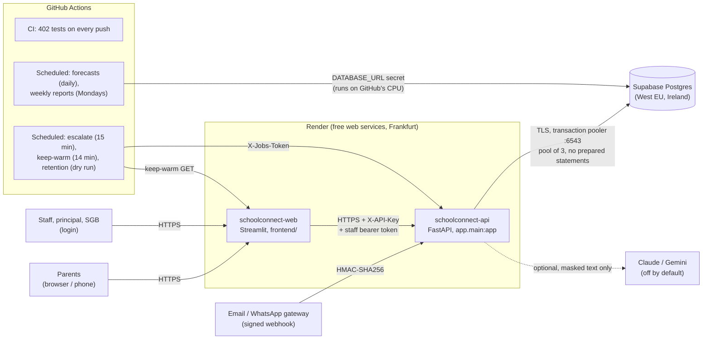

# SchoolConnect technical documentation

This is for a **technical reviewer**: how the system is built, why, how it is tested, and how it
performs on the free hosting it runs on. For the non-technical story, read
[BUSINESS_CASE.md](BUSINESS_CASE.md). To deploy it, follow [DEPLOYMENT.md](DEPLOYMENT.md).

## 1. Architecture

- **Two services, one repository.** `render.yaml` (a Render Blueprint) defines both. The frontend
  never imports backend code; it talks to the API over HTTP, as a phone app would.
- **Heavy work runs on GitHub.** Computing a forecast takes about 2 minutes on Render's 0.1 CPU
  (section 8), so a nightly GitHub job computes it, **signs** it and stores it in Supabase. The API
  only reads it.
- **Light, time-critical work calls the API.** Escalation and the retention dry run go through the
  API, so they use the app's own rules and audit trail.

## 2. Modules by week

| Week | Module | Main code |
|---|---|---|
| 1 | Classification engine: 7 categories, 4 urgencies, 5 languages, child-safety guardrails | `app/taxonomy.py`, `app/classifier/` |
| 2 *(built in 6)* | Reply drafts from school facts only, in three tones | `app/responses/`, `config/school_info.yaml` |
| 3–4 *(built after 7)* | Analytics, insights, weekly PDF reports | `app/analytics/`, `app/reports/`, `app/api/reports.py` |
| 5 | Forecasting: 4 methods, rolling backtest, workload per role, spikes, recommendations | `app/forecasting/`, `config/school_calendar.yaml`, `config/workload.yaml` |
| 6 | AI risk & compliance: PII masking, audit log, fairness, prompt-injection suite, risk PDF, retention | `app/privacy/`, `app/audit.py`, `app/risk/` |
| 7 | Workflow: logins and roles, events, auto-assignment, SLAs, escalation, outbox, fee exemptions, webhook | `app/auth/`, `app/workflow/`, `app/notify/`, `app/integrations/`, `config/workflow.yaml` |
| 8 | Deployment and optimisation: Render Blueprint, Supabase engine, production checks, stored forecasts, scheduled jobs, smoke test, speed-ups | `render.yaml`, `app/db.py`, `app/config.py`, `app/forecasting/service.py`, `.github/workflows/jobs.yml`, `scripts/` |

## 3. Data model

There are 11 tables, all created by SQLAlchemy at start-up. `app/db.py: migrate()` then adds any
column an older database is missing. It is idempotent, and works on SQLite and Postgres.

| Table | Holds | Personal data? |
|---|---|---|
| `tickets` | message, optional parent name/contact/grade, classification, status, assignee, SLA fields | **yes** (anonymised by retention) |
| `responses` | reply drafts and approved replies | possibly (masked by retention) |
| `ai_audit_log` | one row per AI decision or human override: method, guardrails, **hash** of masked input, PII **counts** | no |
| `ticket_events` | the timeline: assigned, status, first response, escalated, notified, fee steps | no (no text, no addresses) |
| `outbox` | every notification and whether it was sent | **yes** (recipient; anonymised by retention) |
| `staff`, `staff_sessions` | accounts (PBKDF2 hash) and logins (SHA-256 of the token) | work email only |
| `fee_exemptions` | checklist, recommendation, decision, reasons | via the ticket |
| `weekly_reports` | report figures (JSON) and the PDF bytes | no (counts only) |
| `forecast_runs` | stored forecast runs (for comparison over time) | no |
| `stored_forecasts` | **Week 8:** signed, pickled forecast bundles for today and the pinned demo dates | no |

Production database size with the demo: about 10,000 tickets, a few MB, far below Supabase's
500 MB free limit.

## 4. API summary (29 endpoints)

Interactive documentation is at `<API>/docs`.

| Group | Endpoints | Access |
|---|---|---|
| Public | `GET /health`, `/taxonomy`, `/stats`; `POST /classify`; `POST /tickets` (API key); `GET /tickets/by-reference/{ref}` (status words only) | anyone / the frontend |
| Auth | `POST /auth/login`, `/auth/logout`; `GET /auth/me` | staff |
| Tickets & replies | `GET /tickets`, `/tickets/{id}`, `PATCH …/status`, `…/classification`, replies, audit, events, outbox, assign, anonymise | staff, **only tickets they may see** (otherwise 404) |
| Workflow | `GET /workflow/my-work`, `GET /staff`, fee exemption steps | staff; fee steps by role (403 / 409) |
| Analytics & reports | `/analytics/*`, `/reports*` | staff, by department |
| Forecast & risk | `/forecast*`, `/analytics/history`, `/risk/*` | **principal and deputy only** |
| Jobs | `POST /jobs/escalate`, `/jobs/retention`, `/jobs/refresh-forecast`, `/jobs/weekly-reports` | `X-Jobs-Token` |
| Integrations | `POST /integrations/inbound-message` | HMAC signature + 5-minute window |

## 5. AI design

1. **Rules first.** `LLM_PROVIDER=rules` is the default and runs fully offline. Keywords in five
   languages give 96% category accuracy on the 150 labelled messages, with 0 missed critical cases
   ([classifier_evaluation.md](classifier_evaluation.md)).
2. **An optional AI.** Claude or Gemini can be switched on. The AI only ever sees **masked** text
   (no ID numbers, phone numbers, emails or the parent's name), must answer in strict JSON, and any
   failure falls back to the rules.
3. **Guardrails can only raise urgency.** They run on the **original** text, after any AI. Abuse,
   missing children, weapons or self-harm are always `critical`, go to the deputy principal and
   need a person. Bullying, injuries or fear are at least `high`. Staff corrections cannot lower a
   safety ticket.
4. **No invented facts.** Replies are templates built from `config/school_info.yaml`. An AI
   rewrite is **rejected** if it adds any number, email, link or placeholder not in the facts.
   Welfare replies are acknowledgement-only and never go to an AI.
5. **Prompt-injection safe.** Parent messages are data. The 23-check suite runs in the tests and on
   the Risk page: rules, an AI that *obeys* the attack, tag wrapping, and reply grounding.
6. **The forecast is checked against simple methods.** Each category uses whichever method won a
   leakage-free rolling backtest. Machine learning is used only if it beats the best simple method
   by at least 2%.
7. **People decide.** Every reply needs staff approval. Every override, escalation and fee
   decision is in the audit log with the logged-in person's name.

## 6. Security and POPIA

Full detail is in [POPIA.md](POPIA.md); this is the technical summary.

- **Least privilege.** Staff see their role's and their own tickets only. Welfare tickets are for
  the deputy principal and principal. Hidden tickets answer 404.
- **Passwords and tokens.** Passwords use PBKDF2-SHA256 with 600 000 iterations, a per-user salt
  and `compare_digest`. After 5 failures the account locks for 15 minutes. Bearer tokens last
  8 hours and are stored only as SHA-256.
- **Safe production start-up.** With `ENVIRONMENT=production`, the API refuses to start without
  `API_KEY` and `JOBS_TOKEN`, with weaker hashing, or on SQLite (`app/config.py`).
- **Secrets.** All secrets are in `.env` (gitignored), the Render dashboard (`sync: false`) and
  GitHub secrets; a test checks that `render.yaml` holds none.
- **Signed stored forecasts.** These are pickled for exact results, so they are **HMAC-signed**
  with a key derived from `JOBS_TOKEN`. A row is unpickled only if the signature, the data
  fingerprint and the library versions all match. A tampered row is ignored, never loaded.
- **Masking everywhere.** PII is masked before any AI call and in every log line. Staff alerts
  contain no message text or parent details, and welfare alerts only the reference.
- **Retention.** Resolved tickets older than 365 days are anonymised: the ticket, its replies and
  its outbox rows. In production this stays a dry run until the principal approves.
- **The webhook.** It uses HMAC-SHA256 over `timestamp.body`, compared with `compare_digest`, and
  rejects requests outside a ±5-minute window.

## 7. Testing

`pytest` runs **402 tests** in about 3 minutes, in CI on every push. They need no internet and no
API keys: the AI, email and HTTP are all mocked.

| Area | Tests | What they prove |
|---|---:|---|
| Classifier, guardrails, taxonomy | 53 | categories/languages/urgency; every safety keyword forces critical/high; guardrails only raise |
| LLM layer | 23 | strict JSON, masking before the call, every failure falls back to rules |
| Privacy, injection, fairness, compliance API | 54 | ID/phone/email masking (Luhn); 23/23 injection checks, and the suite fails if a guardrail is removed; planted bias gets flagged |
| Replies | 8 | facts only from school_info; tones differ; welfare is acknowledgement-only |
| Forecasting + API | 28 | no leakage in the backtest; model choice; workload maths; January backtest |
| Stored forecasts + optimisation | 10 | stored = computed exactly; tampered/stale/unsigned never used; the faster workload lookup matches the old one |
| Analytics & reports | 24 | metrics, insights and PDFs |
| Auth & roles | 28 | hashing, lockout, 8-hour expiry, welfare visibility, the actor is the logged-in person |
| Workflow | 39 | migration on a Week 6 schema; events; auto-assignment by hours; SLA over weekends and Easter holidays; idempotent escalation |
| Fee exemptions | 42 | all 30 state transitions, valid and invalid; 403 for the wrong role; reasons required |
| Notifications & webhook | 21 | dry run, SMTP mocked, no PII in alerts, retention cleans the outbox; HMAC, tampering, replay |
| API & frontend client | 32 | endpoints; bearer token sent; friendly error text; per-login cache |
| Deployment & jobs (Week 8) | 36 | no secrets in `render.yaml`; Python 3.11 everywhere; production start-up refuses bad settings; schedules in school hours and never on the hour; retries; smoke test 9/9 in-process; demo scripts run end to end |

## 8. Performance (measured 2026-10-28)

`python scripts/measure_performance.py` runs the real API in-process on a copy of the demo
database (about 9,900 tickets over 24 months). It samples memory every 20 ms. `--cpu 0.1` puts the
process in a Windows Job Object with a **hard cap of 0.1 of one core**, which simulates Render's
free instance.

| Step | Laptop, full speed | **Capped at 0.1 core** | Peak memory |
|---|---:|---:|---:|
| API start-up (imports) | 2.8 s | **21.5 s** | 134 MB |
| Forecast for 2025-12-15, computed live (4 endpoints) | 12.0 s | **150.8 s** | 225 MB |
| Same forecast again (memory cache) | 0.3 s | **5.4 s** | 225 MB |
| **Forecast after a restart, read from the stored result** | 0.6 s | **7.7 s** | 229 MB |
| All 6 weekly reports with outlook | 12.8 s | **149.0 s** | 231 MB |
| Weekly report PDF download (stored) | 0.0 s | **0.0 s** | 224 MB |
| Risk & compliance page data | 0.8 s | **10.7 s** | 248 MB |
| Same again (classifier check cached) | 0.5 s | **4.1 s** | 250 MB |
| Risk report PDF (built on request) | 0.6 s | **7.1 s** | 250 MB |

**Peak memory: 250 MB of 512 MB.** No memory reduction was needed (the threshold was 400 MB).

### What the numbers led to

| Finding | Change | Effect |
|---|---|---|
| A live forecast would take **2.5 minutes** on Render | the nightly GitHub job stores signed forecasts for today and the pinned demo date | the backtest view reads one in **7.7 s** (capped) instead of 151 s |
| Weekly reports take about 150 s on Render | they run on GitHub against Supabase | no load on the live API |
| 94% of a forecast request's time was 2,700 pandas MultiIndex lookups in `workload.py` | a plain dict built once | **30–60× faster** (0.93 s to 0.016 s); results identical (tested) |
| scikit-learn (and scipy) loaded at start-up | imported only when a forecast is *computed* | start-up 4.9 s to 2.8 s; **39 s to 21.5 s** capped; memory baseline 204 to 134 MB |
| The Risk page re-ran the 150-message classifier check on every load | cached per process (a copy is returned) | −0.3 s per load (−3 s capped) |
| The Risk page built the PDF on every load | built only when the button is pressed | −7 s per load (capped) |
| The inbox fetched each audit trail twice | fetched once | one fewer API call per ticket |
| Slow queries? | every query is ≤ 6 ms on 10k tickets | **no new indexes** (none justified) |

The evaluations were re-run after the changes. The January 2026 backtest is unchanged: forecast
**421** vs actual **486** (16% error), **84%** of days inside the range, admin clerk **86%** vs
**88%**. The classifier is still at 96.0% with 0 missed critical cases.

## 9. Known limitations

- **The free tier sleeps.** After 15 minutes without traffic a service sleeps. Waking takes about
  a minute plus about 20 s of API start-up at 0.1 CPU. Keep-warm covers weekdays 07:00–16:30 SAST;
  outside that, open the URLs early.
- **0.1 CPU.** Pages that compute something (risk summary, analytics) take a few seconds on Render.
  A forecast for a date that has not been stored (not today, not pinned) takes about 2.5 minutes.
- **No email from Render free.** Its outbound SMTP ports are blocked, so `NOTIFY_MODE=dry_run` and
  notifications stay in the outbox. Real email needs a paid instance or an HTTP email API.
- **Free Supabase.** No backups, and the project pauses after 7 days without activity (the daily
  job prevents it).
- **GitHub schedules.** Runs can be late at busy times, and schedules switch off after 60 days
  without a commit.
- **Logins don't survive a refresh.** A browser refresh logs staff out (on purpose: the token is
  never stored on disk or in the URL).
- **Synthetic data.** All data is synthetic and the calendar approximate, so the accuracy figures
  are optimistic ([DATA.md](DATA.md)).
- **Names in messages.** Learner names typed inside a message are not detected by the PII masker.
- **Exact webhook repeats.** A webhook request repeated within 5 minutes creates a second ticket
  (there is no list of signatures already seen).
