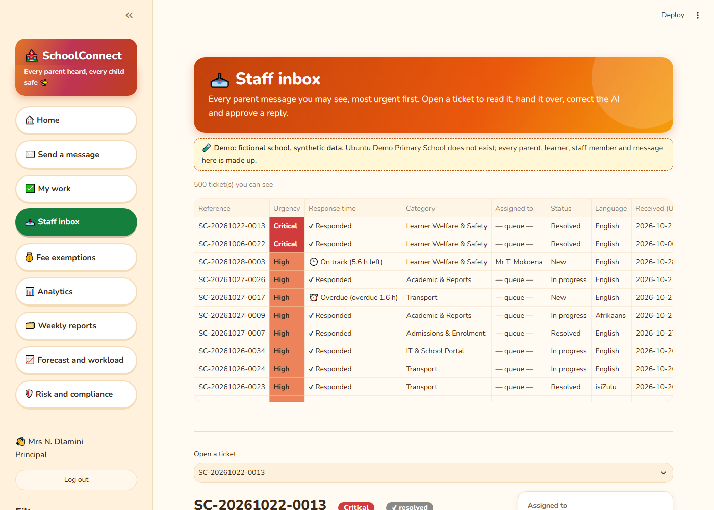
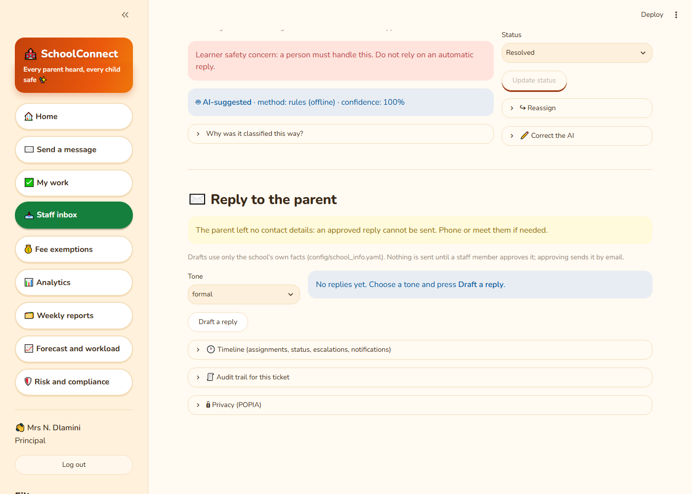
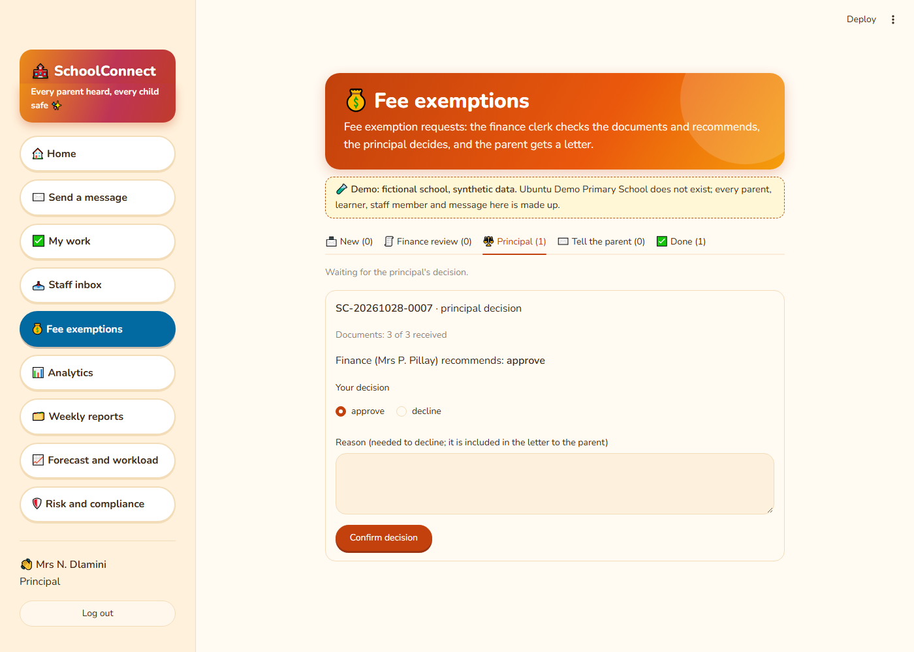
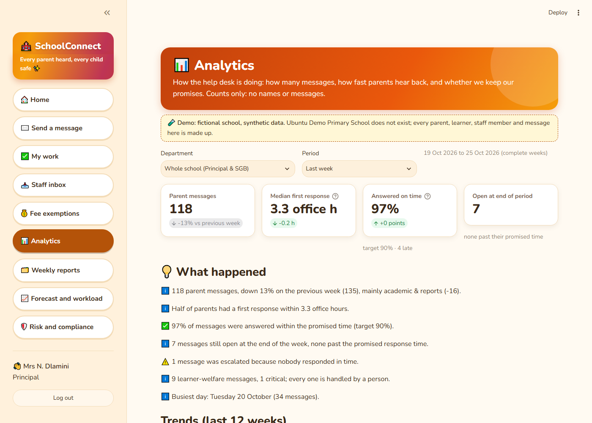
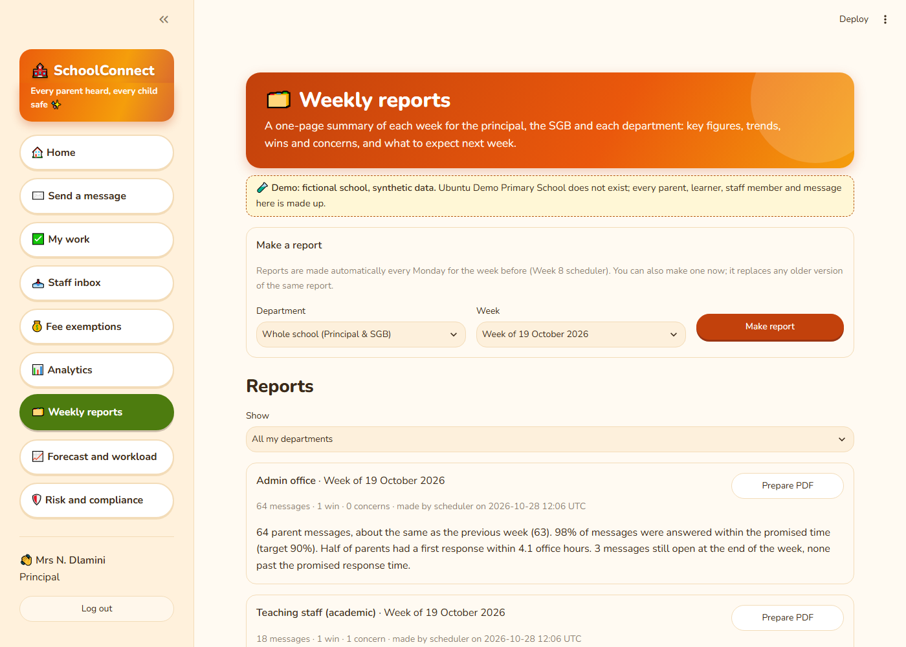
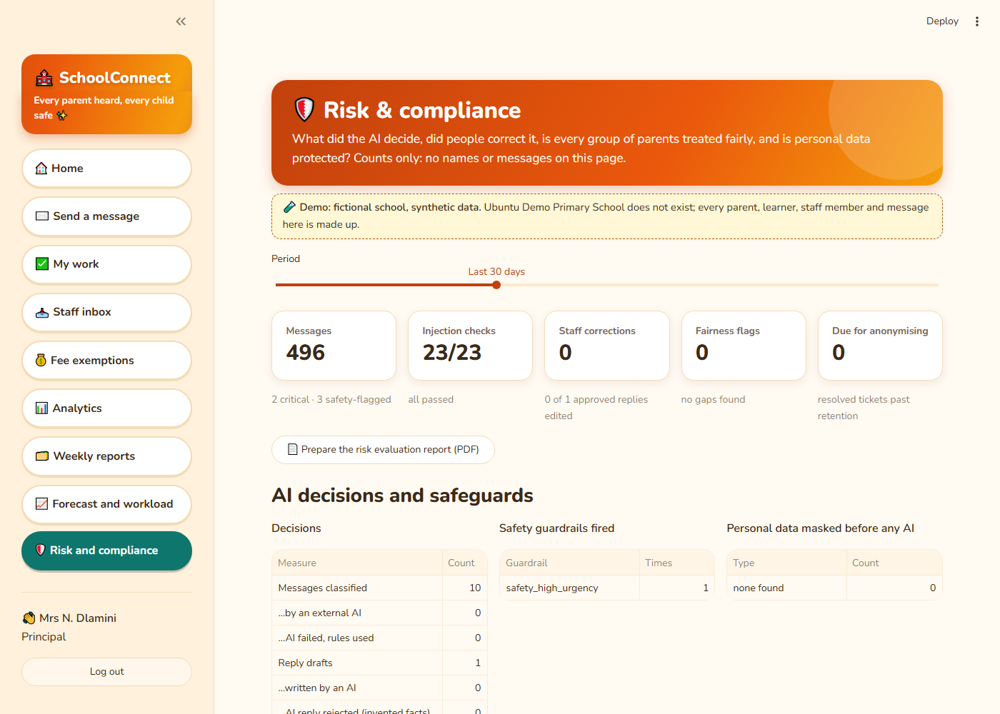

# SchoolConnect user guide

SchoolConnect is the school's help desk.
- **Parents** send a message and get a reference number.
- **Staff** see the messages that are theirs, reply, and pass things on.
- **The principal and the SGB** see how the office is doing and what is coming.

> 🧪 The live demo is a **fictional school with made-up data** ("Ubuntu Demo Primary School").
> Nothing you type there reaches a real school.

---

## 1. Parents

You don't need an account.

### Send a message

1. Open SchoolConnect and choose **Send a message**.
2. Write your question in **any language you are comfortable with**: English, isiZulu, Sesotho,
   Afrikaans or isiXhosa.
3. If you want an answer by email, add your **email address**. Your name and grade are optional.
4. Press **Send message**. You get a **reference number**, for example `SC-20261028-0013`. Use the
   copy button next to it and keep it safe.

> If a child is in **immediate danger**, do not wait for a reply. Phone **10111** (SAPS), or
> **112** from a cellphone.

### Check on your message

At the bottom of the same page, under **Check my message**, type your reference number and press
**Check**. You will see one of these:

- **We have received your message**
- **A staff member is working on it**
- **Your message has been dealt with**

It also says whether the school has replied.

**Your privacy.** Only school staff see your name and contact details. They are never sent to an
AI service. Messages about a child's safety are seen only by the deputy principal and the
principal.

---

## 2. Staff

The school office creates your account and gives you a work email address and a password.

### Log in

Open any staff page (for example **My work**), type your **work email** and **password**, and
press **Log in**.
- Move between pages with the **menu on the left**. If you refresh the browser, you must log in
  again.
- After 5 wrong passwords the account locks for 15 minutes.
- Press **Log out** when you finish.

### My work: your own tickets

New messages are given **automatically** to the person in the right role with the least open
work. Learner-safety messages always go to the deputy principal.

- **Overdue first.** The coloured badge shows the time left before the school's promised answer
  time (for example "5.8 h left"), or how late it is ("overdue 3 h").
- **▶ Start** tells the parent's clock you have responded.
- **✔ Resolve** closes the ticket, and the parent gets a "resolved" message.
- **↪ Hand over** passes it to a colleague (you can add a reason).
- If nobody acts in time, SchoolConnect **escalates** the ticket automatically. For example, a
  class teacher's late ticket goes to the deputy principal.

### Staff inbox: every ticket you may see

- **Find tickets.** Use the filters on the left. The most urgent tickets are at the top.
- **Open a ticket** to read the message. You can see:
  - who it is assigned to and the response time;
  - **why the AI chose that topic**;
  - the **timeline** of everything that happened;
  - the **audit trail**.
- **Reply to the parent.** Choose a tone and press **Draft a reply**. The draft uses only the
  school's own facts. Edit it if you like, then press **Approve and send**. It tells you whether
  the reply was sent by email, queued, or needs a phone call (for parents who gave a phone
  number).
- **Correct the AI** if the topic or urgency is wrong. Safety tickets can never be made less
  urgent.
- **Privacy (POPIA).** If a parent asks, remove their personal details from a ticket.

### Fee exemptions (finance clerk and principal)

1. From a fees ticket in the inbox, choose **💰 Fee exemption → Start a fee exemption request**.
2. **Finance clerk:**
   1. **Start review**.
   2. Tick each document received, then **Save checklist**.
   3. Recommend **approve** (all documents needed) or **decline** (a reason is needed).
3. **Principal:** **Confirm decision**. A decline needs a reason, which goes into the letter.
4. **Send the letter to the parent.** Every step is recorded with your name.

---

## 3. Principal and SGB

### Analytics: how did the office do?

Messages per week, how fast parents heard back, how many answers were **on time**, escalations,
and learner-welfare cases. These are counts only: no names and no messages.

### Weekly reports

Every Monday a one-page report is made for the whole school and for each department. Press
**Prepare PDF**, then **Download**, to share it with the SGB.

### Forecast and workload: what is coming?

Expected messages for the next weeks, which staff will be **busy or overloaded**, and what to do
about it. The **Backtest demo** shows the forecast made on 15 December 2025 for the January rush,
next to what really happened.

### Risk and compliance: is the AI safe and fair?

- What the AI decided, and how often staff corrected it.
- **Personal data masked** before any AI saw it.
- **Fairness checks** by language and grade.
- The **23 prompt-injection checks**.
- A downloadable **risk report**.

---

## Need help?

| Problem | What to do |
|---|---|
| The page takes a minute to open | The free demo server was asleep. Wait; the next pages are quick |
| "Your login has expired" | Log in again (logins last 8 hours) |
| "Too many failed logins" | Wait 15 minutes, or ask the office to check your account |
| A parent gave only a phone number | Phone them: SMS and WhatsApp replies are not available yet |
